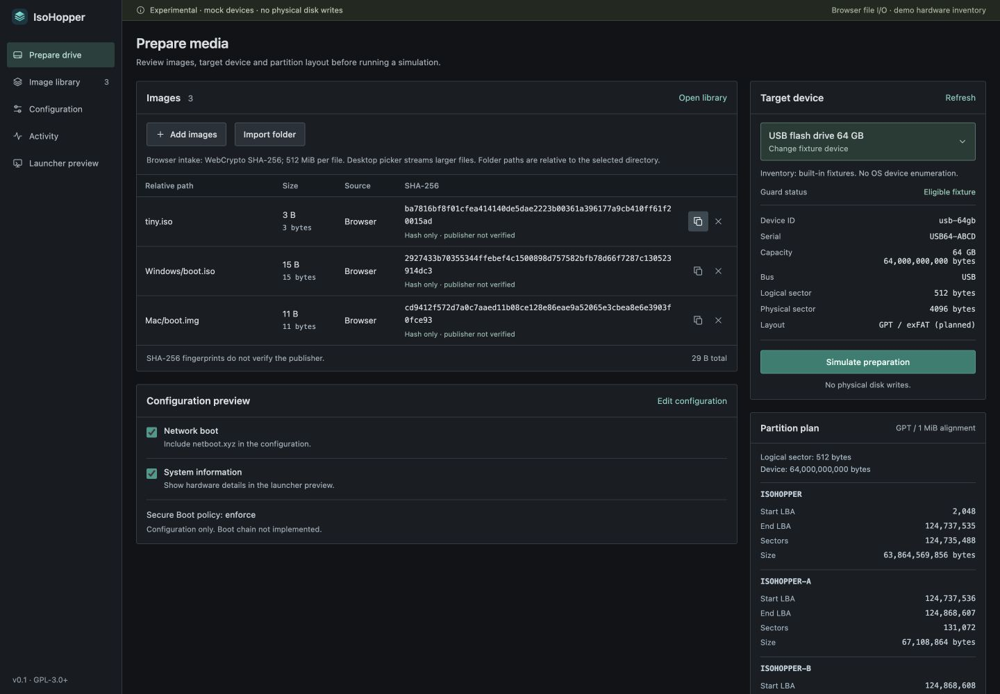
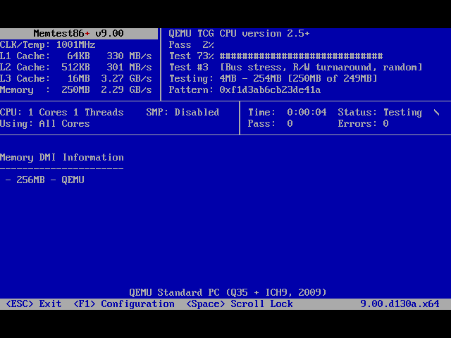

# IsoHopper

> **SUPER EXPERIMENTAL — pending human testing.**
> Physical disk writes are disabled. Hardware and operating-system boot compatibility have not been established.

IsoHopper is a Rust toolkit for image inspection, device safety checks and experimental multiboot media. Studio is its Tauri desktop interface.

Public releases are on hold until real USB preparation and operating-system boot tests pass. The first human-test target is the Windows app preparing a USB for an x64 UEFI PC. Current CI packages are development artifacts, not a working multiboot release.



*Screenshot uses a simulated target and tiny local test files with real checksums.*

## Current capabilities

- Rust CLI: recursive image inspection, streaming checksums, YAML/TOML configuration, supplied-key signed-manifest validation, and partition planning.
- Studio: native file and folder selection, streaming SHA-256, full checksums, relative folder paths, configuration editing, and operation logs. Browser-only intake is limited to 512 MiB per file.
- Read-only macOS, Linux and Windows device inspection. Host devices remain blocked from preparation.
- Labelled mock devices, preparation simulation and typed confirmation; no disk writes.
- New GPT test images with verified primary/backup metadata and FAT32 A/B boot slots. Existing files are refused; the data partition remains unformatted.
- An x64 UEFI launcher with confirmed EFI utility handoff and configurable reboot/shutdown/firmware-setup actions. Firmware security policy applies. Studio power controls are inert previews.

Image inspection and checksum calculation do not prove publisher authenticity or boot compatibility. Physical-device preparation, an end-to-end OS boot workflow, and production Secure Boot signing remain unavailable.

## Build and run

Use the pinned Rust toolchain in `rust-toolchain.toml` and Node.js 22.12 or newer. Native Studio builds also need the [Tauri 2 platform prerequisites](https://v2.tauri.app/start/prerequisites/).

From the repository root:

```sh
cargo run -p isohopper-cli --locked -- --help
cargo run -p isohopper-cli --locked -- devices --json
cargo run -p isohopper-cli --locked -- list --demo
npm --prefix studio/frontend ci
npm --prefix studio/frontend run build
```

Build a local macOS app bundle with the pinned Tauri CLI:

```sh
(cd studio/src-tauri && npx --yes @tauri-apps/cli@2.12.4 build --bundles app)
```

This builds locally. The packaging workflow can build development artifacts manually or when an experimental tag is pushed; publication is disabled while the real USB workflow is incomplete.

For the browser demo, run `npm --prefix studio/frontend run dev` and append `/?demo=1` to the local origin printed by Vite. Demo mode uses labelled fixtures. Native Studio uses real file selection and host inspection; it never falls back to fixtures.

## Checks

```sh
./scripts/check.sh --install-browser
cargo test --manifest-path studio/src-tauri/Cargo.toml --locked
```

The shared script checks Rust, frontend code, and Chromium at desktop and compact widths. Native Studio tests are separate. See [CONTRIBUTING.md](CONTRIBUTING.md) for local development, browser-test discovery without execution, and the optional QEMU firmware smoke test. A passing firmware-entry test is not evidence of OS boot compatibility.

Validation on 28 October 2026:

- **310 Rust workspace tests, 17 native tests, 34 frontend tests, 41 Python tests and 58 Chromium cases passed locally.** The workspace includes 12 catalogue tests also covered by native tests. Browser bridge tests use mocks; filesystem tests use real temporary files. Hosted results are in [Actions](https://github.com/IsoHopper/isohopper/actions).
- [Windows storage integration](https://github.com/IsoHopper/isohopper/actions/runs/40708807100) passed source-handle protection, nested copies, a 256 MiB VHD write/readback, reattachment, GPT validation, FAT32 volume locks, source-to-disk mapping, source-change rejection and read-only disk refusal. This exercised real Windows storage APIs on disposable virtual disks, not USB hardware.
- QEMU passed firmware entry, EFI utility handoff/return, and confirmed guest power requests. The next firmware setup screen was not inspected.
- An Ubuntu 6.8.0-147 kernel reached PID 1 in a tiny diagnostic initramfs and shut down cleanly. With disposable Secure Boot keys, its signed unified kernel image booted; unsigned, tampered and revoked copies were refused. The smaller EFI test utility passed the same four cases.

The diagnostic is not an Ubuntu installer. General ISO booting, installation compatibility, physical hardware and production signing remain unvalidated. Test recipes and mocks are included; generated images and keys are not.



*[Memtest86+ 9.00](https://memtest.org/) reached its testing screen through IsoHopper in QEMU using the checksum-verified official EFI binary. This proves that utility handoff, not a completed memory test, hardware compatibility, or Secure Boot enforcement.*

## Relation to Ventoy

[Ventoy](https://www.ventoy.net/en/index.html) provides direct image booting and extensive compatibility coverage. IsoHopper is an independent, early-stage implementation focused on inspectable metadata and explicit device authorization. It does not yet offer equivalent coverage or replace Ventoy.

## License and contact

Original source © 2026 S33G, licensed under [GPL-3.0-or-later](LICENSE). See [contributors](CONTRIBUTORS.md), [contribution guidance](CONTRIBUTING.md), and [security reporting](SECURITY.md).
