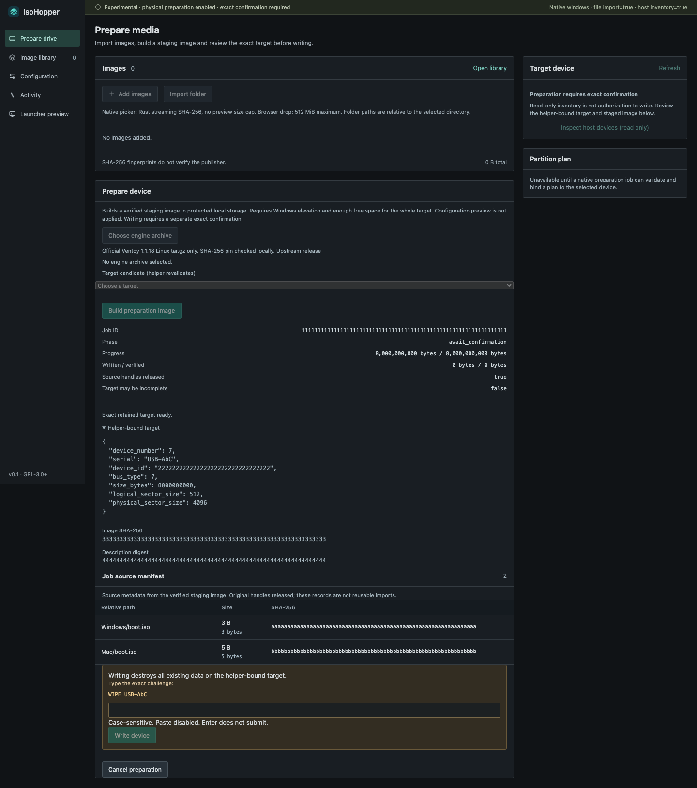
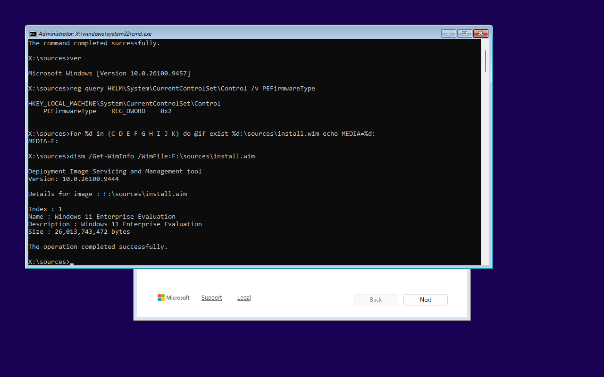

# IsoHopper

> **SUPER EXPERIMENTAL — pending human testing.** Windows preparation writes real devices after explicit confirmation. No physical USB or general OS installation compatibility is claimed.

A Rust media toolkit for administrators: nested image libraries, full checksums, native device evidence and explicit write confirmation.



*Mocked Windows bridge and device, shown for UI review. Not hardware evidence.*

## Current scope

- **Native imports:** files and folder trees, including `Windows/Win11.iso` and `Mac/MacOS.img`. Rust streams SHA-256; native pickers have no browser preview size cap.
- **Session restore:** saved image selections are reopened and rehashed. Settings and engine selection persist; changed or missing files are reported.
- **Windows preparation:** installed helper, private GPT/exFAT staging, verified copies, exact target confirmation and complete device write/readback. Images are optional. Download the pinned engine in Studio or choose an offline copy.
- **macOS / Linux:** real device inspection and local image hashing. USB preparation is not implemented.
- **CLI:** inspect devices/images, validate configuration and create test images. `image engine` requires the pinned external archive and leaves its data partition unformatted.

The separate Rust UEFI launcher supports EFI handoff and confirmed power actions. Its settings and Studio previews are **not applied to current engine media**. Native Studio never substitutes mock devices. Checksums identify bytes, not their publisher or boot compatibility.

## Try it

Read the [Windows preparation guide](docs/usb-preparation.md) for engine setup, installation, staging space and first human test. Download an experimental build from [Releases](https://github.com/IsoHopper/isohopper/releases). Windows prepares media; macOS and Linux currently inspect and hash. Engine download and session restore are included from `v0.1.0-experimental.3`; earlier builds use manual archive selection.

For source builds, use the pinned Rust toolchain, Node.js 22.12+ and [Tauri prerequisites](https://v2.tauri.app/start/prerequisites/). Windows also requires [building and staging the matching helper](CONTRIBUTING.md#development) before Studio.

```sh
cargo run --locked -p isohopper-cli -- --help
npm --prefix studio/frontend ci
npm --prefix studio/frontend run build
(cd studio/src-tauri && npx --yes @tauri-apps/cli@2.12.4 build)
```

## Test evidence

Run `./scripts/check.sh --install-browser`; native Studio tests use `cargo test --manifest-path studio/src-tauri/Cargo.toml --locked`. [Development details](CONTRIBUTING.md).

Observed on 28 October 2026:

| Check | Result and limit |
| --- | --- |
| Rust | 485 workspace tests passed; 4 explicit fixtures skipped. Strict Clippy passed. |
| Studio | 86 native tests passed, 2 opt-in fixtures skipped; 51 frontend tests and 112 Chromium cases passed. Browser bridge/device cases use mocks. Native file tests use real temporary files. |
| Engine | Official pinned archive downloaded, hashed and reused from cache in a separate live test. Stream failures and cancellation use mocks. |
| Packaging | 36 release-script tests passed. Publication requires all four native packages, exact-revision Windows checks and verified asset checksums. |
| Windows | Previous release: [installed Studio integration passed](https://github.com/IsoHopper/isohopper/actions/runs/40755258703). [Production staging and disposable-disk validation passed](https://github.com/IsoHopper/isohopper/actions/runs/40755258573), including nested copies, confirmation, write/readback and locks. Every release repeats these gates at its exact revision. No physical USB tested. |
| Boot | Rust-built GPT booted Alpine 3.24.3 in QEMU; mounted ISO hash matched. Windows Setup read its WIM in an adjusted GPT fixture, not an unchanged Studio-to-USB test. |

<details>
<summary>Windows Setup test screenshot</summary>



Actual x64 UEFI guest. Diagnostic GPT geometry was adjusted to match a transplanted exFAT filesystem. No OS installation or physical USB test.

</details>

Interactive UAC, physical USB behavior, broad firmware/OS compatibility and Secure Boot signing remain unvalidated. Windows packages are unsigned; macOS packages are not notarized. [Current Actions](https://github.com/IsoHopper/isohopper/actions).

## Relation to Ventoy

[Ventoy](https://www.ventoy.net/en/index.html) supplies the mature boot compatibility work. IsoHopper uses pinned Ventoy 1.1.18 components downloaded on request or supplied offline, adding Rust preparation and inspectable verification. It is not yet a complete replacement. No upstream boot binaries or OS images are bundled. [Third-party components](THIRD_PARTY.md).

## License and contributors

Original source © 2026 S33G. [GPL-3.0-or-later](LICENSE) · [Contributors](CONTRIBUTORS.md) · [Contributing](CONTRIBUTING.md) · [Security](SECURITY.md)
