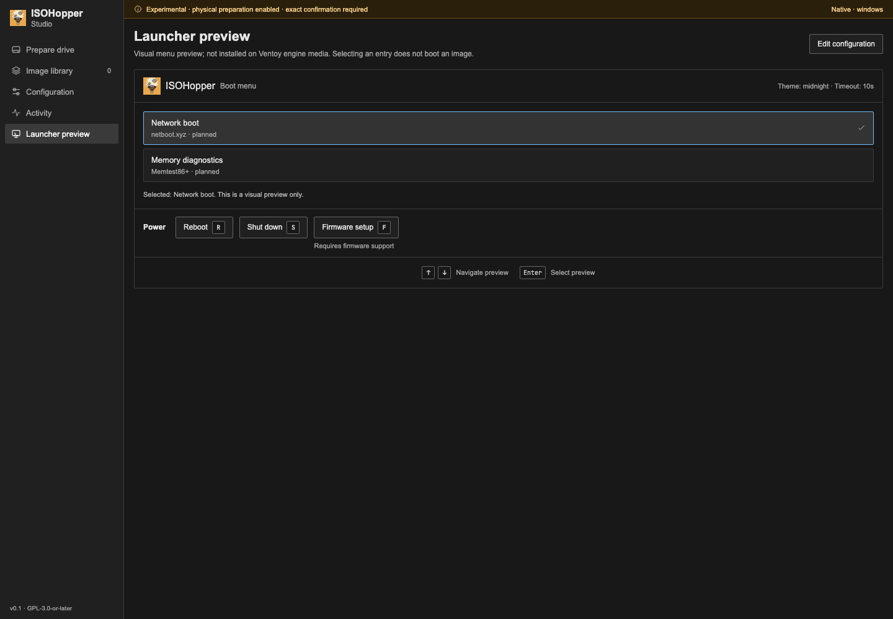
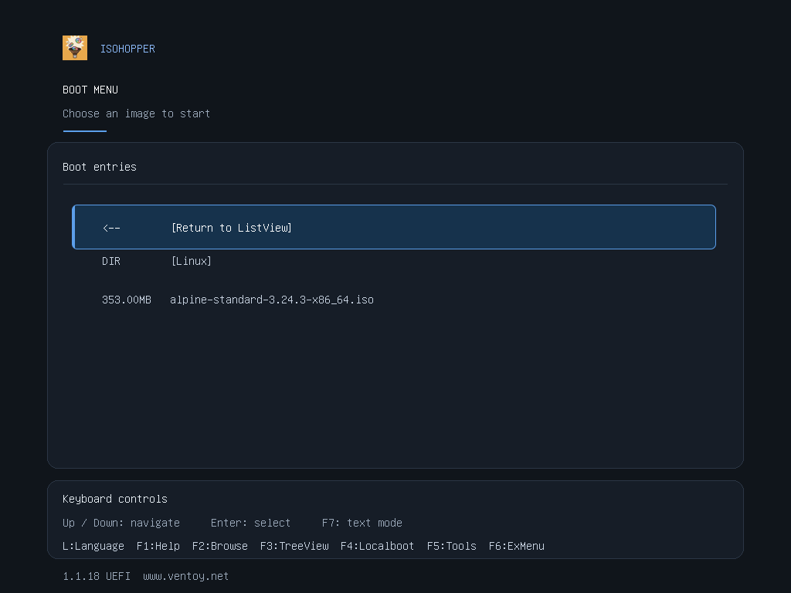

# ISOHopper

> **SUPER EXPERIMENTAL — pending human testing.** Windows preparation writes real devices after explicit confirmation. No physical USB or general OS installation compatibility is claimed.


A Rust media toolkit for administrators: nested image libraries, full checksums, native device evidence and explicit write confirmation.


*Mocked Windows bridge and device, shown for UI review. Not hardware evidence.*

<details>
<summary>Launcher preview</summary>



Local preview with mocked runtime data; this menu is not installed on current engine media.

</details>

<details>
<summary>Installed USB theme</summary>



Actual x64 UEFI guest using the bundled theme and real image entries. The engine menu is separate from Studio's richer preview; this is virtual-machine evidence, not a physical USB test.

</details>

## Current scope

- **Native imports:** files and folder trees, including `Windows/Win11.iso` and `Mac/MacOS.img`. Rust streams SHA-256 for large files; checksums and device identifiers can be copied in full.
- **Session restore:** saved image selections are reopened and rehashed. Settings and engine selection persist; changed or missing files are reported.
- **Windows installation:** choose a drive, select **Install ISOHopper**, review its identity, enter or paste `ENABLE_WRITE`, then confirm. The installed helper prepares an empty GPT/exFAT bootable drive and verifies the full write by readback. No ISO selection; copy files onto the USB afterwards. The pinned engine downloads automatically or can be supplied offline.
- **USB boot menu:** newly prepared drives include an IsoHopper theme, real engine entries, existing tools and F7 text fallback. Existing drives are not updated automatically.
- **macOS / Linux:** real device inspection and local image hashing. USB preparation is not implemented.
- **CLI:** inspect devices/images, validate configuration and create test images. `image engine` requires the pinned external archive and leaves its data partition unformatted.

The separate Rust UEFI launcher supports EFI handoff and confirmed power actions. Its settings and Studio previews are **not applied to current engine media**. Native Studio never substitutes mock devices. Checksums identify bytes, not their publisher or boot compatibility.

## Try it

Download from [Releases](https://github.com/IsoHopper/isohopper/releases), then follow the [Windows preparation guide](docs/usb-preparation.md). The current source includes the empty-drive wizard; releases before experimental.6 use the earlier controls.

Prebuilt releases target Windows x64, Linux x64 and Apple silicon macOS. Intel Mac users can [build from source](CONTRIBUTING.md#intel-mac-source-build).

For source builds, use the pinned Rust toolchain, Node.js 22.12+ and [Tauri prerequisites](https://v2.tauri.app/start/prerequisites/). Windows also requires [building and staging the matching helper](CONTRIBUTING.md#development) before Studio.

```sh
cargo run --locked -p isohopper-cli -- --help
npm --prefix studio/frontend ci
npm --prefix studio/frontend run build
(cd studio/src-tauri && npx --yes @tauri-apps/cli@2.12.4 build)
```

## Test evidence

Run `./scripts/check.sh --install-browser`; native Studio tests use `cargo test --manifest-path studio/src-tauri/Cargo.toml --locked`. [Development details](CONTRIBUTING.md).

Local checks on 29 October 2026:

| Check | Result and limit |
| --- | --- |
| Rust | 511 workspace tests and 4 firmware-policy tests passed; 4 fixtures skipped. Updated confirmation tests and strict Clippy passed. |
| Studio | 87 native tests passed, 2 opt-in fixtures skipped. 55 frontend unit tests and 146 Chromium cases passed. Browser checks use mocked IPC/devices; native file tests use temporary files. |
| Engine | Official pinned archive downloaded, hashed and reused from cache in a separate live test. Stream failures and cancellation use mocks. |
| Tooling | 70 Python tests passed. Release-note checks were repeated after edits. |
| Windows | Release gates require installed Studio and disposable-VHD checks at the exact revision. Installed UAC-token coverage is explicitly unavailable on runners without a split token. No physical USB write or boot test. |
| Boot | Rust-built GPT booted Alpine 3.24.3 in QEMU; mounted ISO hash matched. Windows Setup read its WIM in an adjusted GPT fixture, not an unchanged Studio-to-USB test. |
| USB theme | Bundled asset hashes verified in QEMU staging. Empty and populated menus, nested folders and text/graphical mode switching checked on x64 UEFI. |

<details>
<summary>Windows Setup test screenshot</summary>


Actual x64 UEFI guest. Diagnostic GPT geometry was adjusted to match a transplanted exFAT filesystem. No OS installation or physical USB test.

</details>

The Windows metadata failure (`os error 87`) was reproduced when a USB driver rejected the optional device-ID query. Current source checks whether that property is supported before treating it as unavailable; required device identity and safety checks remain in place. Patched native read-only binding and revalidation passed on the same USB drive, with no writes, locks or dismounts. Other metadata errors are not claimed fixed. Helper-disconnect diagnostics still need human retesting. Interactive UAC, physical USB writes and booting, broad OS compatibility and Secure Boot signing remain unvalidated. Windows packages are unsigned; macOS packages are not notarized. [Current Actions](https://github.com/IsoHopper/isohopper/actions).

## Relation to Ventoy

[Ventoy](https://www.ventoy.net/en/index.html) supplies the mature boot compatibility work. IsoHopper uses pinned Ventoy 1.1.18 components downloaded on request or supplied offline, adding Rust preparation and inspectable verification. It is not yet a complete replacement. No upstream boot binaries or OS images are bundled. [Third-party components](THIRD_PARTY.md).

## License and contributors

Original source © 2026 S33G. [GPL-3.0-or-later](LICENSE) · [Contributors](CONTRIBUTORS.md) · [Contributing](CONTRIBUTING.md) · [Security](SECURITY.md)
